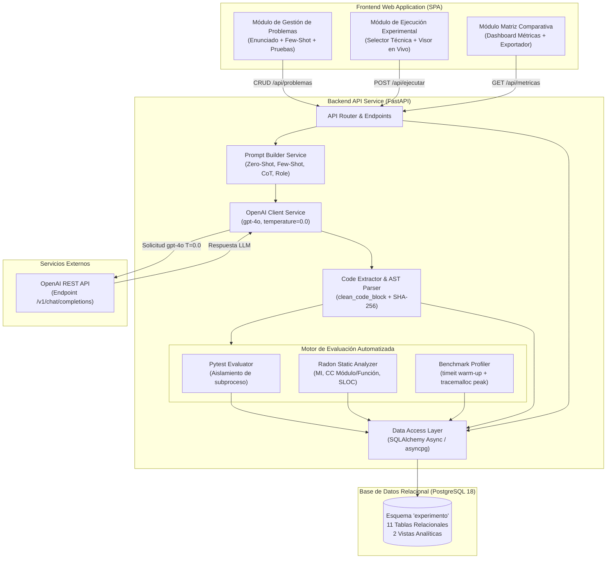
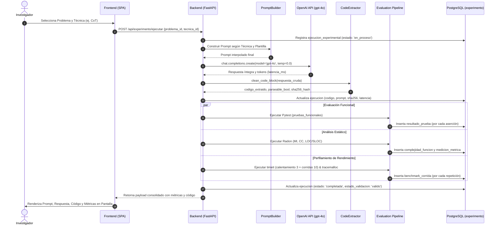
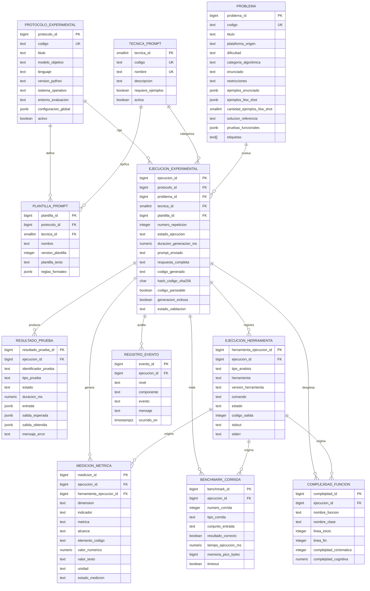

# Documento 02: Diseño de Arquitectura del Sistema
## Plataforma de Investigación Experimental (Prompt Engineering Research Lab)

**Tesis:** *Técnicas de Estructuración de Prompts en la Calidad de Código Generado por el Modelo de Lenguaje de Gran Escala ChatGPT-4o*  
**Metodología:** Cascada Adaptada (Fase 2: Diseño)  
**Versión:** 1.0.0  
**Fecha:** 2026-10-26  
**Autor:** Ingeniero de Software Principal / Arquitecto de Software  

---

## 1. Visión Arquitectónica General

La plataforma experimental adopta una arquitectura en capas desacopladas orientada a servicios (Layered Service-Oriented Architecture), diseñada específicamente para garantizar:
- **Reproducibilidad y Determinismo Experimental:** Inferencia estricta con `temperature=0.0`, trazabilidad criptográfica mediante hashes SHA-256 de cada artefacto generado.
- **Aislamiento en la Ejecución:** Los módulos de evaluación funcional (Pytest) y de rendimiento (`timeit`, `tracemalloc`) operan en entornos de ejecución controlados para mitigar interferencias del sistema operativo o efectos colaterales de código generado.
- **Integridad de Datos Científicos:** Desacoplamiento estricto entre mediciones en crudo (corridas individuales de benchmark y aserciones unitarias) y métricas agregadas sintetizadas en vistas relacionales de PostgreSQL.

```
+-----------------------------------------------------------------------------------+
|                           CAPA DE PRESENTACIÓN (FRONTEND)                         |
|   +--------------------------+  +--------------------------+  +-------------------+
|   | Interfaz 1: Ingesta      |  | Interfaz 2: Ejecución    |  | Interfaz 3:       |
|   | y Gestión de Problemas   |  | Experimental en Vivo     |  | Matriz Comparativa|
|   +--------------------------+  +--------------------------+  +-------------------+
+-----------------------------------------|-----------------------------------------+
                                          | HTTP / JSON REST APIs
+-----------------------------------------v-----------------------------------------+
|                         CAPA DE CONTROL Y APLICACIÓN (FASTAPI)                     |
|   +--------------------------+  +--------------------------+  +-------------------+
|   | Router de Problemas      |  | Router de Ejecuciones    |  | Router de Métricas|
|   +--------------------------+  +--------------------------+  +-------------------+
+-----------------------------------------|-----------------------------------------+
                                          |
+-----------------------------------------v-----------------------------------------+
|                               CAPA DE SERVICIOS CORE                              |
|  +------------------+  +-------------------+  +---------------+  +---------------+|
|  | PromptBuilder    |  | OpenAIService     |  | CodeExtractor |  | EventLogger   ||
|  | Service          |  | (ChatGPT-4o, T=0) |  | (clean/AST)   |  | Service       ||
|  +------------------+  +-------------------+  +---------------+  +---------------+|
|  +-------------------------------------------------------------------------------+|
|  |                     PIPELINE DE EVALUACIÓN MULTI-DIMENSIONAL                   ||
|  |  +---------------------+  +---------------------+  +------------------------+  ||
|  |  | FunctionalEvaluator |  | MaintainabilityEval |  | PerformanceBenchmark   |  ||
|  |  | (Pytest Runner)     |  | (Radon MI, CC, LOC) |  | (timeit + tracemalloc) |  ||
|  |  +---------------------+  +---------------------+  +------------------------+  ||
|  +-------------------------------------------------------------------------------+|
+-----------------------------------------|-----------------------------------------+
                                          | SQLAlchemy Async / asyncpg
+-----------------------------------------v-----------------------------------------+
|                         CAPA DE PERSISTENCIA (POSTGRESQL 18)                      |
|                               Esquema "experimento"                               |
|   +--------------------------+  +--------------------------+  +-------------------+
|   | Tablas Operacionales     |  | Tablas de Medición Cruda |  | Vistas Analíticas |
|   | (problema, ejecucion,    |  | (resultado_prueba,       |  | (vw_resumen_      |
|   | protocolo, tecnica, ...) |  | benchmark_corrida, ...)  |  | pruebas / bench)  |
|   +--------------------------+  +--------------------------+  +-------------------+
+-----------------------------------------------------------------------------------+
```

---

## 2. Diagrama de Componentes

El siguiente diagrama detalla la interacción entre los componentes del Frontend, la API del Backend, los evaluadores especializados y la base de datos relacional.



---

## 3. Diagrama de Flujo de Datos y Pipeline Experimental

El flujo de procesamiento para cada ejecución individual sigue una secuencia lineal e inmutable:



---

## 4. Modelo Entidad-Relación de la Base de Datos

El diseño del esquema relacional `experimento` implementa una separación estricta entre definición de problemas, configuración del protocolo, ejecuciones y mediciones empíricas.



---

## 5. Diccionario y Reglas del Esquema

1. **Protocolo Inmutable (`protocolo_experimental`):** Establece el marco experimental científico. Registra las versiones exactas del hardware, kernel y entorno evaluador (ej. Arch Linux, Python 3.14).
2. **Segregación de Ejemplos en `problema`:**
   - `ejemplos_enunciado`: Ejemplos contextuales para comprensión del problema.
   - `ejemplos_few_shot`: Casos de demostración (código/explicación) inyectados **únicamente** en la técnica Few-Shot.
   - `pruebas_funcionales`: Conjunto de aserciones automatizadas Pytest para evaluación de exactitud.
3. **Métricas Crudas vs Agregadas:**
   - La tabla `benchmark_corrida` preserva cada repetición individual de medición (separando corridas de `calentamiento` de las de `medicion`).
   - La tabla `resultado_prueba` preserva el estatus y tiempo de cada aserción Pytest.
   - La vista `vw_resumen_pruebas` computa en tiempo de ejecución `% pruebas aprobadas`.
   - La vista `vw_resumen_benchmark` computa tiempos promedio, mediano, mínimo, máximo y memoria mediana sin imputaciones arbitrarias.
4. **Regla de Integridad de Fallas:** Si un código no compila o produce error en tiempo de ejecución, el campo `valor_numerico` en `medicion_metrica` se conserva como `NULL` y el campo `estado_medicion` se etiqueta como `error` o `no_disponible`. **Nunca se escribe 0** para evitar sesgos en el análisis de varianza estadístico.
